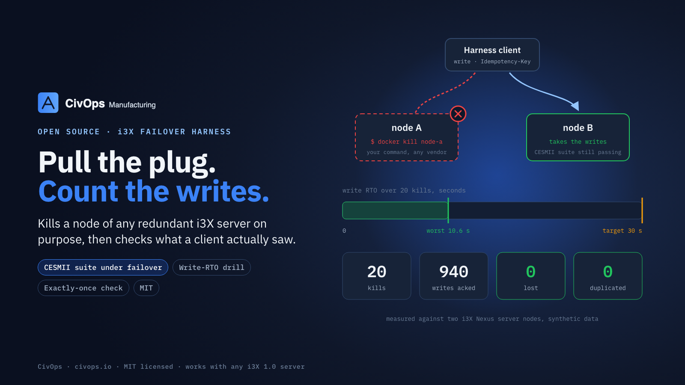

# i3X failover harness

Proves that a redundant [CESMII i3X](https://www.cesmii.org/) 1.0 server keeps working when one of its nodes dies. It works against any i3X server: it talks plain i3X 1.0 over HTTP, and taking a node down is a command you supply (`docker kill`, `systemctl kill`, a power-strip API, anything).



Two modes:

| Mode | What it proves |
|---|---|
| `conformance` | CESMII's own i3X 1.0 conformance suite, run against the surviving endpoint while your command kills the other node part-way through, still passes |
| `drill` | Over N forced failures under continuous write load, how long a client waits before a write is acknowledged again (the write RTO), and that every acknowledged write is in the server's history **exactly once**: nothing lost, nothing duplicated |

## How the drill works

1. One client writes continuously with `PUT /objects/value`, one update at a time, each with its own `Idempotency-Key`. A write that is not acknowledged (refused, 5xx, timeout, connection reset) is retried with the **same key** on the next endpoint in the list until one acknowledges it.
2. Each cycle: write for `--settle` ms, run `--kill`, and start the clock when the kill command returns. The cycle's write RTO is the time until the first write *sent after that moment* is acknowledged. Then run `--restart` and wait until every endpoint answers `GET /info`.
3. At the end, read the element's history back with `POST /objects/history` through any endpoint that answers, and count every write key found in it. Each acknowledged key must appear exactly once.

A write that the server applied but whose acknowledgement was lost is retried under the same key; a server that honours the key stores it once, and the drill accepts that. A server that stores it twice is reported under `duplicated`. A write acknowledged but missing from history is reported under `lost`.

Requirements on the server: the element you write to must keep every write in its history (a versioned record, or a historised value), and retries with the same `Idempotency-Key` must not apply twice. Your kill command must not return until the node is really down; a SIGKILL'd process or container is.

## Use

Requires Node 22 or later. The bearer token, if the server needs one, is read from `I3X_TOKEN` so it stays out of the process list.

```bash
npm install
```

### Drill

```bash
I3X_TOKEN=… npx tsx src/cli.ts drill \
  --endpoint http://node-a:8080/v1 --endpoint http://node-b:8080/v1 \
  --element signal:ship-eta \
  --value '{"value":{"status":"active","order":"{{key}}"}}' \
  --kill 'ssh node-a sudo systemctl kill -s KILL my-i3x' \
  --restart 'ssh node-a sudo systemctl start my-i3x' \
  --cycles 20 --rto-target 30000 --out reports/failover-drill.json
```

| Flag | Default | Meaning |
|---|---|---|
| `--endpoint` (repeat) | — | every node's i3X base URL; writes rotate through them on failure |
| `--element` | — | the element written to and read back |
| `--value` | `{"value":{"key":"{{key}}"}}` | the update's `value`; `{{key}}` becomes the write's unique key |
| `--kill`, `--restart` | — | shell commands; `I3X_CYCLE` is set in their environment |
| `--cycles` | 20 | forced failures |
| `--rto-target` | 30000 | ms; a cycle with no acknowledged write by then fails |
| `--settle` | 1500 | ms of steady writing before each kill |
| `--write-timeout` | 15000 | ms per write attempt (longer than the server's takeover, if it holds writes through one) |
| `--out` | `reports/failover-drill.json` | the full report |

Exit code 0 means pass.

### Conformance under failover

Get the suite from the `conformance-tests` folder of the i3X repository ([github.com/cesmii/i3X](https://github.com/cesmii/i3X)); it has no dependencies. It is not bundled here.

```bash
I3X_SUITE=~/i3X/conformance-tests I3X_TOKEN=… npx tsx src/cli.ts conformance \
  --endpoint http://node-b:8080/v1 \
  --kill 'ssh node-a sudo systemctl kill -s KILL my-i3x' --kill-after 500 \
  --restart 'ssh node-a sudo systemctl start my-i3x' \
  --out reports/conformance-failover.json
```

`--kill-after` is ms after the suite starts. The run fails if the suite finishes before the kill (lower it; a full suite run can take under two seconds), if any conformance test fails, or if the surviving endpoint is not answering afterwards. `--out` is the suite's own JSON report.

## Reading the drill report

Abridged, from the Nexus run below (one of its 20 cycles shown):

```json
{
  "cycles": [{ "cycle": 9, "rtoMs": 10408, "killCommandMs": …, "restartedInMs": 760 }, …],
  "writeRtoMs": { "max": 10563, "median": 10385, "target": 30000 },
  "acknowledgedWrites": 940, "attempts": 960,
  "readBack": { "values": 941, "matched": 940 },
  "lost": [], "duplicated": [], "appliedUnacknowledged": [],
  "pass": true, "failures": []
}
```

- `attempts` above `acknowledgedWrites` is normal: those are the retries during each takeover.
- `readBack.values` counts everything in the element's history in the window, including versions written by others; `matched` counts this run's keys.
- `appliedUnacknowledged` lists writes the server holds although the client never got an acknowledgement (the run ended mid-retry). They are allowed; they are listed so you can see them.

## Worked example: an i3X Nexus pair

The numbers above are from a run against two [i3X Nexus](https://github.com/LNS-Research/i3x-nexus-profile) reference nodes sharing one PostgreSQL, each in its own Docker container, with a 10 s governor lease: 20 forced failures of whichever node held the write lease, write RTO max 10.6 s (median 10.4 s), 940 writes acknowledged, 0 lost, 0 duplicated. Run under the same conditions, the conformance suite against the surviving node, with the lease holder killed 0.5 s in, gave Full 1.0 Compliance (53 passed, 0 failed).

`examples/kill-leader.sh` and `examples/restart-killed.sh` are the commands used. The kill script asks `/info` which node holds the write lease (a Nexus extension, `x-nexus.redundancy.governor`) and kills that container; for another server, replace the lookup with whatever tells you which node is primary, or kill a fixed node.

```bash
NODES="a=http://127.0.0.1:8411/v1 b=http://127.0.0.1:8412/v1" CONTAINER_PREFIX=my-pair- \
I3X_TOKEN=… npx tsx src/cli.ts drill \
  --endpoint http://127.0.0.1:8411/v1 --endpoint http://127.0.0.1:8412/v1 \
  --element signal:ship-eta --value '{"value":{"status":"active","order":"{{key}}"}}' \
  --kill 'sh examples/kill-leader.sh' --restart 'sh examples/restart-killed.sh'
```

`examples/programmatic.ts` runs the same drill from code.

## Test

```bash
npm test
```

The tests run the harness against a fake redundant pair (two HTTP servers over one store, one write leader, a takeover delay) and check that a correct pair passes with the RTO it was given, that a lost acknowledgement retried under its key is not a duplicate, that a lost write and a duplicated write are each caught, that a pair that never takes over fails on the RTO target, and that a failing kill command ends the drill as a failure. The conformance mode is tested with a stand-in for the suite (`tests/fixtures/suite`). No network beyond 127.0.0.1, synthetic data only.

## License

MIT. See [LICENSE](LICENSE). From [CivOps](https://civops.io).
